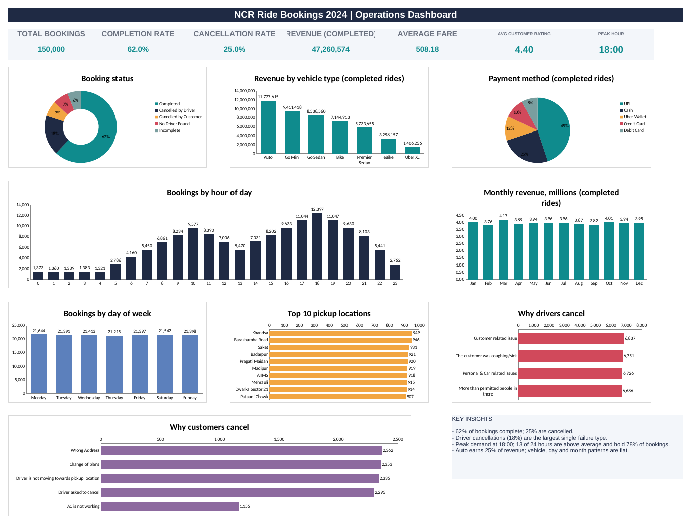

# NCR Ride Bookings Analysis (2024)

End-to-end analysis of **150,000 ride bookings** from the Delhi NCR region: data cleaning and EDA in **Python**, 27 business questions answered in **SQL Server**, and an interactive **Excel dashboard**.

## Business question
Where do bookings fail, when is demand highest, and which vehicles, routes and payment methods drive revenue?

## Tools
| Stage | Tool |
|-------|------|
| Cleaning and EDA | Python (pandas, NumPy, Matplotlib), Jupyter / Colab |
| Analysis queries | SQL Server (CTEs, window functions, `RANK`, `LAG`, running totals, `PERCENTILE_CONT`) |
| Dashboard | Excel (pivot-style calc sheet, 9 charts, KPI cards) |

## Repository structure
```
ncr-ride-bookings-analysis/
├── notebooks/NCR_Ride_Booking_Analysis.ipynb   # Phase 1 cleaning + Phase 2 EDA (24 questions)
├── sql/ride_booking_analysis.sql               # 27 SQL questions
├── dashboard/Ride_Bookings_Dashboard.xlsx      # Operations dashboard
├── data/README.md                              # where to put the CSVs
├── images/                                     # dashboard screenshots
└── requirements.txt
```

## Data cleaning (Python)
- Standardised column names (`Booking Status` → `booking_status`)
- Removed stray quotes from `booking_id` / `customer_id`, trimmed whitespace
- Combined date and time into `booking_datetime`; derived hour, day and month
- Checked missing values by booking status: nulls in ratings, payment, distance and fare for non-completed rides are **expected**, so they were kept as NaN
- Filled the three "reason" columns with `Not Applicable`
- Checked duplicates: repeated booking IDs belong to different customers and dates, so they were kept
- Checked categories for spelling inconsistencies

## Key findings
- **Completion rate is 62%**; 25% of bookings are cancelled and 6% end incomplete.
- **Drivers cancel 2.6x more than customers** (27,000 vs 10,500). The top customer reasons are wrong address, change of plans and driver not moving towards pickup (about 22% each).
- **Demand peaks at 18:00** (12,397 bookings) with a morning peak around 10:00. Nights from 00:00 to 04:00 are the quietest.
- **Day and month barely matter.** Weekday and weekend volumes per day are almost identical (410 vs 413), and months range only from 11.9k to 12.9k bookings.
- **Revenue is ₹47.26M** from completed rides, average fare ₹508, median ₹414. Auto earns the most (24.8% share), Uber XL the least (3.0%).
- **Vehicle type has little effect on completion**: only a 1.2-point gap between best (Uber XL, 62.6%) and worst (Go Sedan, 61.4%).
- **UPI is the most used payment method** (45% of rides), then cash (25%).
- **Distance does not drive fare** (correlation 0.006), so fares are not distance-based in this dataset.
- **99.2% of customers booked only once**, so repeat-usage analysis is limited.
- Pickup areas with the lowest completion rate: Vinobapuri (54.7%), Akshardham (56.1%), Chhatarpur (58.1%).

## Dashboard


KPIs: total bookings, completion rate, cancellation rate, revenue, average fare, average customer rating, peak hour.

## How to run
```bash
git clone https://github.com/<your-username>/ncr-ride-bookings-analysis.git
cd ncr-ride-bookings-analysis
pip install -r requirements.txt
# put the CSVs in /data (see data/README.md), then:
jupyter notebook notebooks/NCR_Ride_Booking_Analysis.ipynb
```
For SQL: create a database `ride_dataset`, import `ride_bookings_cleaned.csv` as `dbo.ride_bookings_cleaned`, then run `sql/ride_booking_analysis.sql` in SQL Server Management Studio.

## Author
Sakina Sayyad · [LinkedIn](https://www.linkedin.com/in/sakina-sayyad/)
